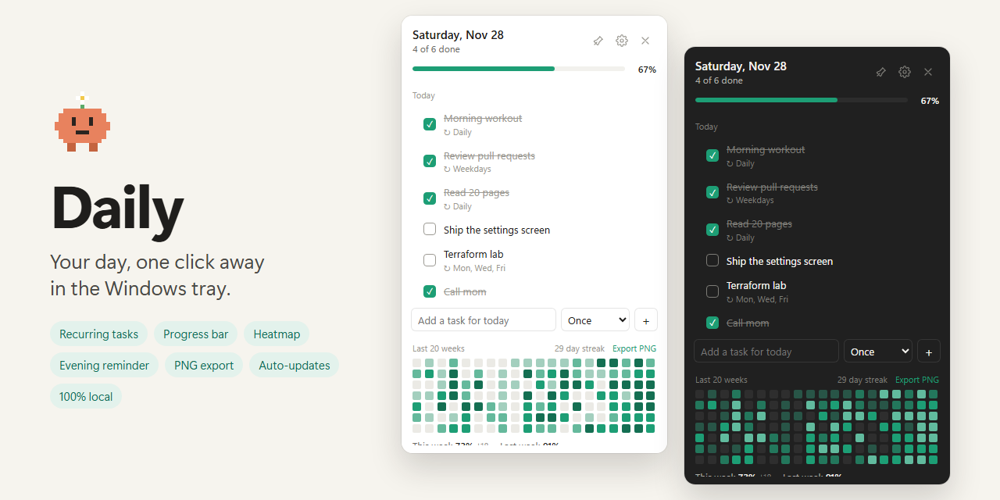
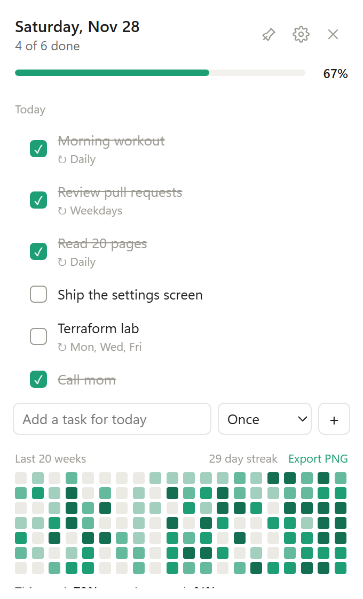
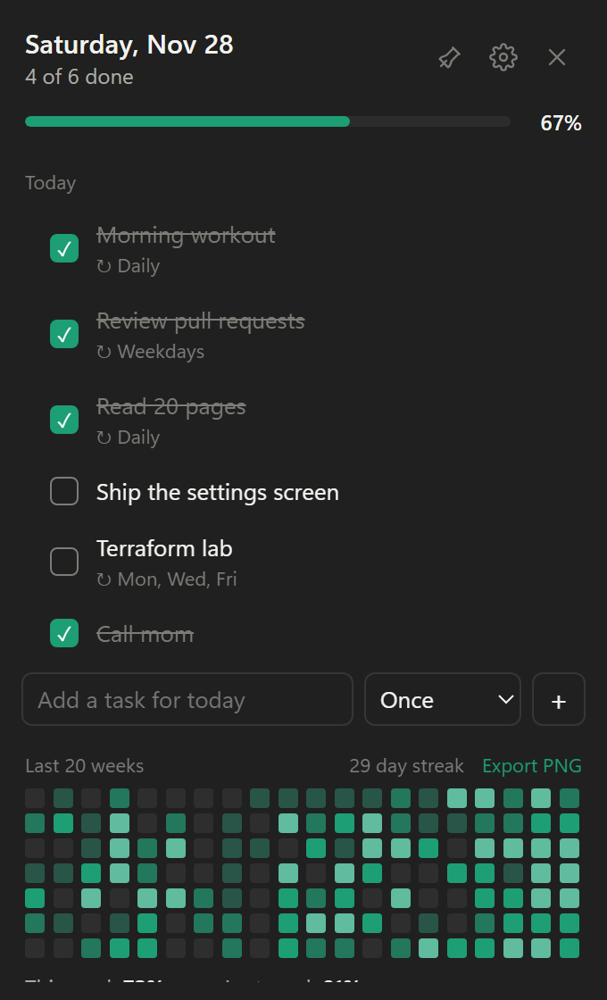
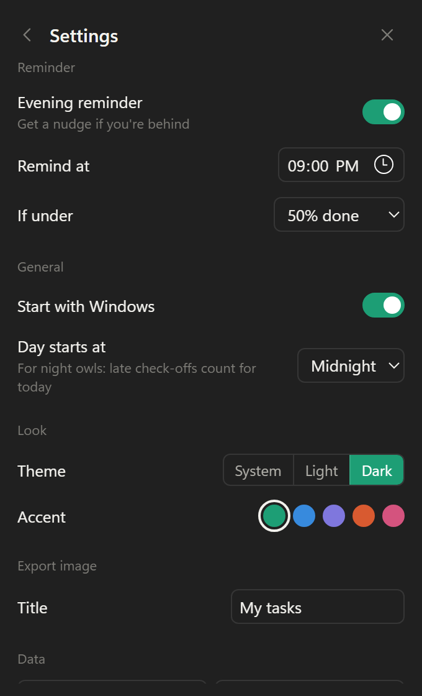
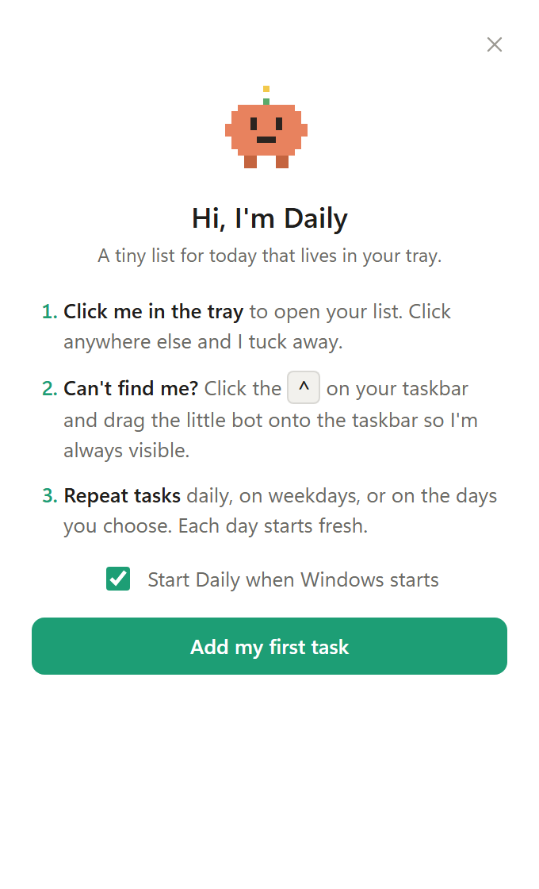
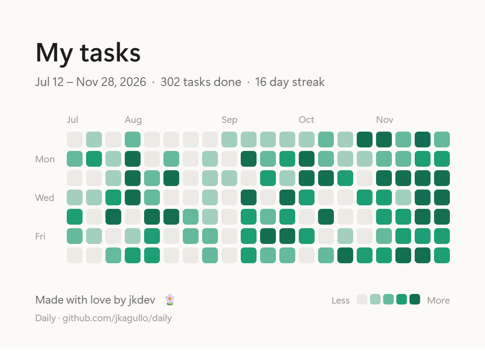

<div align="center">



# Daily

**A tiny, always-there task panel that lives in your Windows tray.**

Plan today, check things off, and watch your streak grow. No account, no cloud. Your data stays on your PC.

[**⬇ Download for Windows**](https://github.com/jkagullo/daily/releases/latest)

</div>

---

## Screenshots

<table>
  <tr>
    <td align="center"><br /><sub>Today, light</sub></td>
    <td align="center"><br /><sub>Today, dark</sub></td>
    <td align="center"><br /><sub>Settings</sub></td>
    <td align="center"><br /><sub>First run</sub></td>
  </tr>
</table>

**Export your heatmap** and share how your month went:



<sub>Screenshots use demo data. See <a href="docs/screenshots/README.md">docs/screenshots</a> to regenerate them.</sub>

## Features

- **Lives in the tray.** Left-click the bot to open today's list; click away and it tucks itself back. Pin it to keep it on top.
- **Recurring tasks.** Once, daily, weekdays, or any days you pick (e.g. Mon/Wed/Fri). Each day gets a fresh copy. Skipped days don't pile up.
- **Progress at a glance.** A progress bar in the panel *and* a tiny one under the tray icon.
- **Heatmap.** A contribution-style grid of the last 20 weeks. Click any square to see what you finished that day, with a this-week vs. last-week summary underneath.
- **Export your heatmap** as a shareable PNG with your own title.
- **Evening reminder.** A gentle Windows notification if you're behind (default: 9 PM, under 50%).
- **Drag to reorder**, **double-click to edit**, **undo on delete**, **light/dark theme**, **accent colors**, **backup & restore**.
- **Auto-updates.** Daily checks GitHub Releases and offers a one-click "Update and restart". Updates are signed, so only official builds install.
- **Light.** Built with [Tauri](https://tauri.app), so it uses the WebView2 that's already part of Windows instead of shipping a whole browser.

## Install

1. Go to the [latest release](https://github.com/jkagullo/daily/releases/latest).
2. Download `Daily_x.y.z_x64-setup.exe` and run it. No admin rights needed.
3. Look for the bot in your tray. It may be hidden under the **^** arrow; drag it onto the taskbar to keep it visible.

> **"Windows protected your PC"?** The installer isn't code-signed (certificates cost money), so SmartScreen warns about any new unsigned app. Click **More info → Run anyway**. The installer is built from this repo's source by [GitHub Actions](.github/workflows/release.yml), so you can check exactly what's in it.

## Using it

| Action | How |
| --- | --- |
| Open / close the panel | Left-click the tray icon · `Esc` or **×** to close |
| Tray menu (start with Windows, quit) | Right-click the tray icon |
| Check off a task | Click it |
| Edit title or repeat days | Double-click it |
| Reorder | Drag the `⋮⋮` handle |
| Stop a repeating task / delete a one-off | Hover → **×** |
| Keep the panel open and move it | Pin it, then drag the header |
| Settings | ⚙ in the header |

**Where's my data?** `%APPDATA%\dev.jkdev.daily\daily.db` (a single SQLite file). Use **Settings → Back up** to save a copy anywhere.

## Build from source

Prerequisites: [Node 20+](https://nodejs.org), [pnpm](https://pnpm.io), [Rust](https://rustup.rs), and the [Tauri Windows prerequisites](https://tauri.app/start/prerequisites/#windows) (MSVC C++ build tools).

```powershell
pnpm install
pnpm tauri dev      # run with hot reload
pnpm test           # unit tests (dates, recurrence, streaks, reminder timing)
pnpm tauri build    # installer → src-tauri/target/release/bundle/nsis/
```

### Project layout

```
src/                    React + TypeScript panel
  components/           TaskList, Heatmap, SettingsView, …
  lib/db.ts             all SQL (tasks, day instances, heatmap)
  lib/settings.ts       settings stored in SQLite
  lib/exportImage.ts    heatmap → PNG (canvas)
  lib/reminder.ts       evening notification
src-tauri/              Rust shell
  src/lib.rs            tray, panel window, dialogs, autostart
  migrations/           SQLite schema
  icons/source.svg      the pixel bot (run `pnpm tauri icon src-tauri/icons/source.svg` after editing)
```

### How the data works

- `tasks` holds what you want to do and how it repeats.
- `task_instances` holds one row per task per day. When you open the panel, today's rows are created for whatever repeats today.
- Checking a task sets `completed_at`. The progress bar, log and heatmap are all just queries over those rows.

### Releasing

Bump `version` in `package.json`, `src-tauri/tauri.conf.json` and `src-tauri/Cargo.toml` (then run `cargo check` so `Cargo.lock` follows), commit, then:

```powershell
git tag v0.2.0
git push origin v0.2.0
```

The [Release workflow](.github/workflows/release.yml) builds the installer, signs it for the updater, and publishes it along with `latest.json`, which installed copies check for updates.

**Updater signing key.** Releases are signed with a private key stored in the repo secret `TAURI_SIGNING_PRIVATE_KEY`. Its public half is `plugins.updater.pubkey` in `tauri.conf.json`. Keep a backup of the private key: if it's lost, existing installs can't verify new updates and everyone has to reinstall manually. Forks must generate their own (`pnpm tauri signer generate`) and replace the pubkey.

## License

[MIT](LICENSE) · made with love by jkdev 🌼
